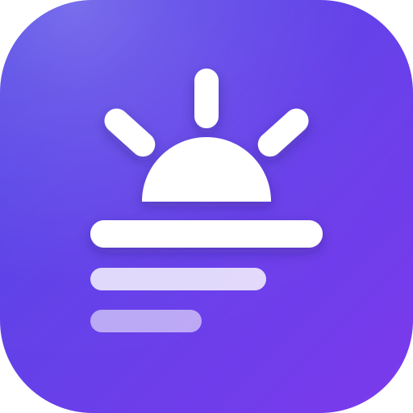

<p align="center">
  
</p>

<h1 align="center">Daybook</h1>

<p align="center">
  <strong>Your day, written down.</strong><br>
  A private journal for what you eat, learn, train and spend, plus a professional trade journal.<br>
  It works offline, installs like an app on phone and desktop, and keeps everything on your device.
</p>

---

## What is Daybook?

Daybook is one calm place for your daily goals. In a few seconds a day you can log a meal, write down the
thing you learned, record a workout, note an expense, and journal your trades. Daybook then turns those
small entries into streaks, trends and honest insights, such as how your mood changes on training days or
how your trading goes after a good night's sleep.

There's no account, no subscription, no ads and no tracking. Your journal lives on your device.

## Feature tour

| Area | What you get |
|---|---|
| **Today** | Your home screen: a day-score ring for your goals, your logging streak, one-tap quick logs, a water tracker, a card for every area, and a reflection journal (mood, energy, sleep, intention, wins, gratitude) that saves as you type. It also brings back something you learned a week, a month or a year ago. |
| **Food** | Breakfast, lunch, dinner and snacks with calories, protein, carbs and fat, a photo and a "how healthy" tag. Calorie and protein rings, water in glasses and litres, one-tap re-logging of your frequent foods, and 7- or 30-day trends. |
| **Learning** | Capture what you learned with a one-line takeaway, source, category and tags. Built-in spaced repetition (Again / Hard / Good) helps it stick, and the library shows your categories, top tags and an activity heatmap. |
| **Training** | Workouts with sets × reps × weight, duration, intensity and distance. Personal records and estimated 1-rep max, exercise progress charts, steps and body weight, a weekly-minutes goal, and "repeat a past workout". |
| **Expenses** | Expenses and income by category and payment method, monthly budgets (overall and per category), a daily spend chart, search, and CSV export. |
| **Trades** | A complete trade journal: entry and exit, stop and target, fees, automatic P&L, R-multiple and return, setups, timeframes, emotions, mistakes and screenshots. **Analytics** covers the equity curve, win rate, profit factor, expectancy, drawdown, P&L by setup, symbol, weekday and hour, what your mistakes cost you, and plain-language insights. There's also a **P&L calendar** and a **daily plan** for pre-market bias, watchlist, rules checklist and max loss, then a post-market review and grade. |
| **Goals** | Goals that check themselves from your logs ("8 glasses of water", "100 g protein", "spend ≤ ₹1,000") or simple daily checkboxes, with streaks and a 30-day hit rate. |
| **Calendar** | Month and year heatmaps of your day score, mood, spending, trading P&L or training. |
| **Insights** | Weekly, monthly and yearly reviews with trends, highlights and *connections* between areas of your life, plus a short written review of each period. |
| **Search** | Find any meal, lesson, workout, expense, trade or journal note instantly. |
| **Made for you** | Light and dark themes, any currency, kg/lb and km/mi, your own categories, setups and rules, backups, CSV export, and sample data to explore before you start. |

## Run it on this PC (Windows)

1. Double-click **`start.bat`** in the Daybook folder.
2. Your browser opens **http://localhost:8080** and Daybook is ready.
3. Keep the small black window open while you use Daybook. Close it when you're done.

`start.bat` needs **Python 3** (free). If it's missing, the window tells you where to get it:
https://www.python.org/downloads/. When you install it, tick **"Add python.exe to PATH"**.

On a Mac or Linux PC, open a terminal in the Daybook folder and run `python3 tools/serve.py --open`.

> **Why not just double-click `index.html`?** Browsers don't run modern app code from files opened
> directly from disk. The tiny local server fixes that, and it never sends anything to the internet.
>
> **Always use the same address.** Your journal is saved per web address, so `http://localhost:8080`
> and `http://127.0.0.1:8080` count as two separate places. `start.bat` always uses the first one.

## Install it as an app

Installed, Daybook gets its own window and icon, opens straight to Today, and works offline.

- **Windows or Mac (Chrome or Edge):** click the install icon at the right end of the address bar, or use
  **Install app** in Daybook's sidebar or in Settings. Right-click the app icon for shortcuts:
  *Today, Add expense, Log meal, Log trade*.
- **Android (Chrome):** tap the menu **⋮**, then **Install app** (or **Add to Home screen**). Long-press
  the icon for the same shortcuts.
- **iPhone or iPad (Safari, iOS 16.4 or later):** tap **Share**, then **Add to Home Screen**.

To install on your phone, Daybook needs a secure **https://** address. The next section shows how to get
one for free.

## Use it on your phone (free hosting)

Phones only allow offline use and installing for sites served over **https**. Free static hosting
gives you that in a few minutes.

**Hosting only serves the app's files.** Your journal is uploaded only if you sign in to sync (see below).

### Option A: GitHub Pages (recommended)

1. Create a free account at **https://github.com**.
2. Click **+ → New repository**. Name it `daybook`, choose **Public**, and click **Create repository**.
   (Free Pages sites need a public repository. Only the app's code is public, never your entries.)
3. On the new repository page, click **"uploading an existing file"**. Open the Daybook folder on your PC,
   select **everything inside it** (Ctrl+A, including the `.nojekyll` file), drag it into the browser,
   wait for the upload to finish, then click **Commit changes**.
4. Go to **Settings → Pages**. Under *Build and deployment*, set **Source: Deploy from a branch**,
   **Branch: `main`** and folder **`/ (root)`**, then click **Save**.
5. After a minute or two the page shows **"Your site is live at https://YOUR-NAME.github.io/daybook/"**.
   Open that address on your phone and install it (see above).

To update later, go to **Add file → Upload files** and upload the changed files the same way.

### Option B: Netlify Drop (fastest)

1. Open **https://app.netlify.com/drop**.
2. Drag the whole **Daybook folder** onto the page.
3. In a few seconds you get an `https://….netlify.app` address. Sign up (free) when asked so the site is
   kept, because drops without an account are temporary. You can rename the address in the site settings.

### Option C: Cloudflare Pages

1. Create a free account at **https://dash.cloudflare.com**.
2. Go to **Workers & Pages → Create → Pages → Upload assets**.
3. Name the project (for example `daybook`), drag in the **Daybook folder**, and click **Deploy**.
4. Open the `https://daybook.pages.dev` address it shows (the name may differ).

### Quick try on the same Wi-Fi (no hosting)

Run `python tools/serve.py --lan` (or `start.bat --lan`). It prints an address like
`http://192.168.1.20:8080/` to open on your phone. If Windows Firewall asks, allow access on
**private networks**. This is fine for a quick look, but on plain `http` your phone can't install the
app or use it offline, so use one of the hosting options for everyday use.

## Your data and privacy

- **Signed out, everything stays on your device.** Entries, photos and settings are saved in your browser's
  built-in database (IndexedDB) and nothing is uploaded.
- **Signed in (Settings → Account & sync), your journal syncs to your own account.** Every device keeps a
  full copy and works offline; changes upload when you're online and appear on your other devices within
  seconds. The data sits in a Supabase (Postgres) database protected by row-level security, so only your
  login can read it. It is not end-to-end encrypted.
- If the same entry is edited on two devices before they sync, the most recent edit wins.
- **Delete everything** (Settings → Data) erases *this device* and signs it out; your synced copy stays in
  your account. Deleting many entries at once asks before removing them from your other devices.
- **Back up regularly**, for example once a week (Daybook reminds you). Clearing your browser's site data
  deletes the journal too. A backup is a single file (photos included) that you can keep in your own cloud
  drive. It holds your private journal, so store it somewhere safe.
- **iPhone and iPad:** Safari may delete data from websites you haven't opened for about 7 days.
  Adding Daybook to your Home Screen protects it. Keep backing up anyway.
- **Keep data persistent:** in Settings, this asks the browser not to clear Daybook's data when your
  device runs low on space.

## Cloud sync setup (one time, for the owner)

1. In Supabase: **SQL Editor → New query**, paste the whole of `supabase/schema.sql`, click **Run**.
2. **Authentication → URL Configuration**: set **Site URL** to `https://day-book.dev` and add these
   **Redirect URLs**: `https://day-book.dev/**` and `http://localhost:8080/**`.
3. The project address and publishable key live in `js/core/sync-config.js` (both are safe to publish).
4. Test locally without Supabase: `python tools/sync_test.py` (two simulated devices against
   `tools/mock_supabase.py`).
## Keyboard shortcuts

| Key | Action |
|---|---|
| `n` | Quick add (log anything) |
| `/` | Search |
| `g` then `t` | Go to Today |
| `Esc` | Close a dialog or sheet |

## Troubleshooting

- **Blank page or "could not start" after opening `index.html` directly:** use `start.bat` (or any of
  the hosting options). The app needs to be served, not opened as a file.
- **"Update ready" appears:** tap **Reload** to switch to the newest version.
- **"My entries are gone!"** You're probably on a different address, browser or device. Check the
  address bar, or restore your latest backup.
- **Port 8080 is busy:** close the program using it and run `start.bat` again. You can use
  `python tools/serve.py --port 8090`, but remember that a different address means a separate journal.

---

## For developers

Daybook has no build step and no dependencies: plain ES modules, CSS and inline SVG. It runs from any
static host, including a sub-folder. The full product and engineering contract is in
[`docs/SPEC.md`](docs/SPEC.md).

```
index.html              app shell (links every CSS file, loads js/app.js)
manifest.webmanifest    PWA manifest (icons, shortcuts)
sw.js                   service worker (offline app shell)
start.bat               Windows launcher
assets/icons/           icon.svg (master), favicon-32, icon-192/512, maskable-512, apple-touch-icon, shortcut-*
css/                    tokens.css, base.css, components.css, charts.css, modules/<page>.css
js/app.js               boot, shell, navigation, quick add, service worker registration
js/core/                db, bus, settings, router, ui, undo, dates, format, charts, icons, metrics, images, backup
js/modules/             one file per page; trades/ holds the trade journal (calc, editor, detail, analytics, ...)
tools/                  dev server, smoke tests, test pages (never cached by the service worker)
docs/SPEC.md            the spec
```

**Dev server:** `python tools/serve.py [--port 8080] [--lan] [--open] [--verbose]`. It serves correct MIME
types (`.js` as JavaScript, `.webmanifest` as a manifest) and sends `Cache-Control: no-cache`, so you
always get fresh files.

**Smoke tests:** `tools/smoke.py` drives your installed Chrome headless through Playwright
(`pip install playwright`, no browser download needed). It reports console errors, page errors and
failed requests, and can take screenshots:

```
python tools/smoke.py --sample --routes all --shots out/desktop
python tools/smoke.py --sample --routes all --mobile --theme dark --shots out/mobile-dark
python tools/smoke.py --page tools/styleguide.html --shots out/styleguide --full
```

It also has a Python API (`app_session()`, `goto_route()`) for scripted interaction tests. See its docstring.

**Test pages** (open them on the dev server, for example `http://localhost:8080/tools/tests/core.html`):

- `tools/tests/core.html`: unit tests for the core modules.
- `tools/tests/sw-test.html`: service worker install, activation, precache coverage, offline shell,
  stale-while-revalidate, the update flow (`SKIP_WAITING`), manifest and icons. It starts from a clean
  slate, so it unregisters the worker and clears Daybook's caches first.
- Both publish `window.__testResults` / `window.__testsDone` for automated runs.

**Styleguide and charts:** `tools/styleguide.html` shows every shared component in light and dark, and
`tools/charts-demo.html` shows every `js/core/charts.js` chart with sample data. Use them when building or
reviewing UI.

**Service worker and releases.** The worker precaches the app shell listed in `SHELL` in `sw.js`, uses
network-first for page loads (with the cached shell as the offline fallback) and stale-while-revalidate
for other files. It never caches `tools/` or `docs/`. When you ship a change, **bump `VERSION` in
`sw.js`**. Installed copies then download the new files in the background and show *"Update ready"*. If
you add a new runtime file, add it to `SHELL` too (otherwise it is cached on first use).

**Data:** IndexedDB database `daybook` (version 1) with stores `meta, days, food, learning, workouts,
expenses, trades, goals, reviews, files`. Backups are JSON:
`{ app: 'daybook', schema: 1, exportedAt, stores: { … } }`, with images embedded as data URLs.
